# Coevo Caddie

**A coach on the phone beside your screen.** Keep working in your usual AI tool. The Caddie watches the screen from your phone, stays quiet while you are on track, and asks one short question when you are stuck. Afterwards it leaves you only what helps, and your AI can learn to ask the right questions first.

**[Watch the demo (2:40)](https://coevo-caddie.coevo-meta-hackathon.workers.dev/demo)** · **[Try it](https://coevo-caddie.coevo-meta-hackathon.workers.dev)** · **[Replay a recorded session, no phone needed](https://coevo-caddie.coevo-meta-hackathon.workers.dev/sample)**

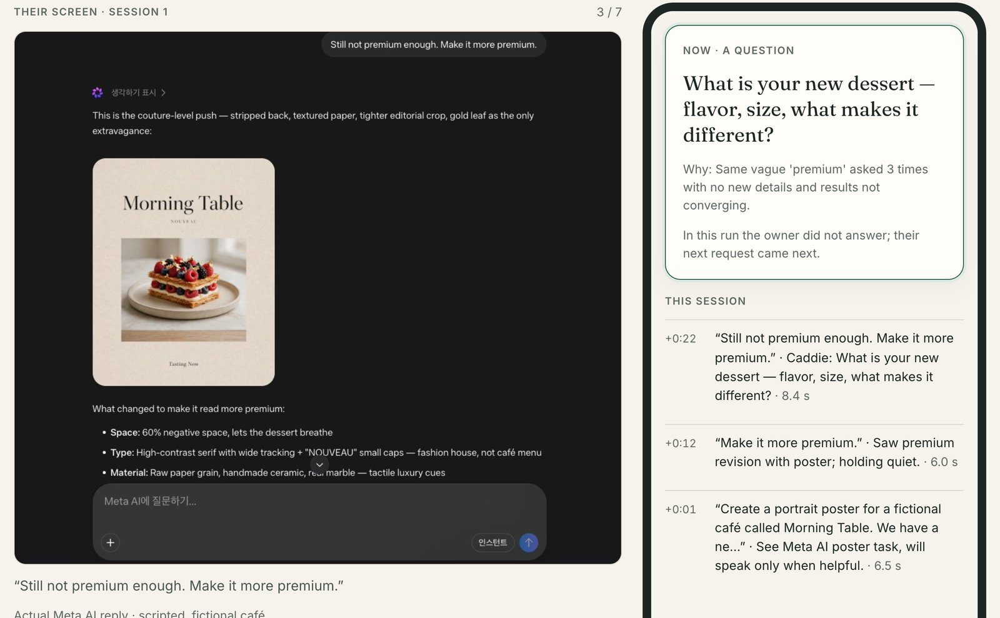
<sub>The recorded sample session (`/sample`): an actual Meta AI reply to a scripted café owner (left) and the Caddie's question on the phone (right).</sub>

## Why

When an AI result is not right, many people just ask again with a vaguer word: *make it more premium*. Nothing tells them what the AI is missing (who it is for, the price, one feeling, a real photo), so the results stay generic. Coevo Caddie turns the phone you already keep beside the monitor into a coach that notices this moment and asks about it, without changing your AI tool or integrating with it.

## Start in a minute

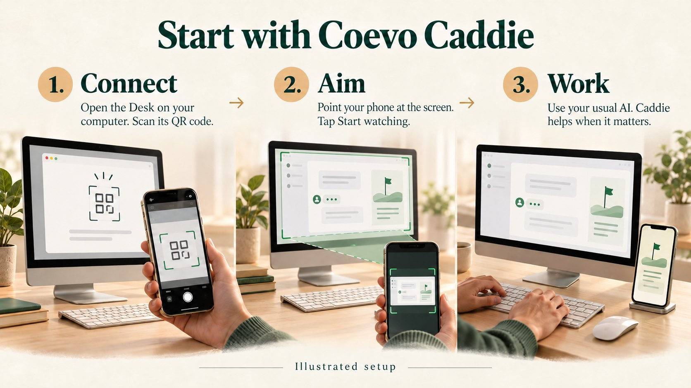
<sub>Illustration, not a screenshot. The real screens follow.</sub>

**1. Open the Desk on your computer.** It shows a pairing code (blurred in this picture) and keeps what each session leaves you.

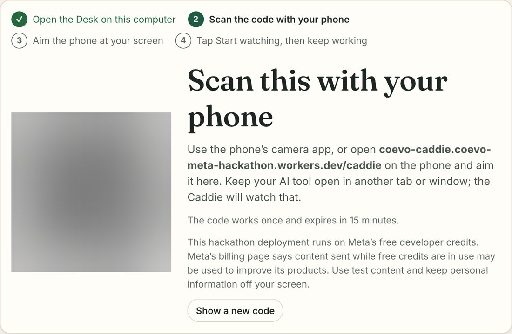

**2. Scan the code with your phone. 3. Aim the phone at your screen** and drag the box around your AI tool. While watching, only the boxed screen area is sent.

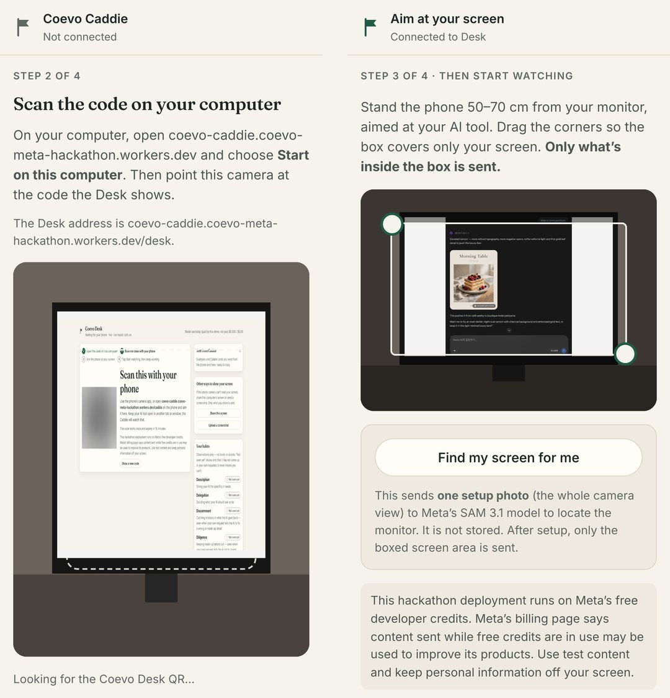

**4. Tap Start watching, then keep working** in ChatGPT, Gemini, Meta AI or Claude, in its usual tab. The Desk confirms the phone is connected.

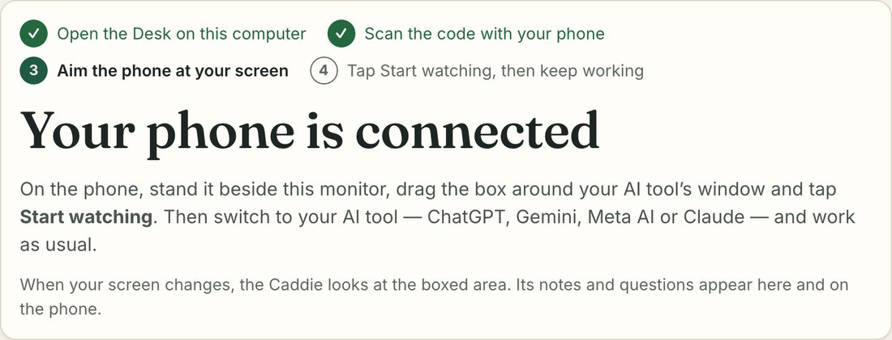

## What happens while you work

A scripted, fictional café owner asks Meta AI for a dessert poster, then types *make it more premium* again and again. The screens in this section come from one later live run of the deployed app, not the recorded sample above (in that recording the owner never answered the question). The phone setup is assumed: a controlled camera showed actual Meta AI replies, and the spoken answer used a synthetic voice.

- **It stays quiet while you are on track, and says why.** Twice: "Second premium poster visible, still iterating."
- **After the third *more premium*, it asks one question:** "What exactly is your new dessert — flavor and what makes it special?"
- **You answer out loud.** It hears *matcha*, sees the poster still shows berries, and names what is missing: "Tell AI your price, your real matcha photo, and who it's for."
- **You write the brief yourself.** The poster changes, and the change is recorded honestly as *with the Caddie*, not *on your own*. SAM 3.1 points at the price on the kept screen photo.

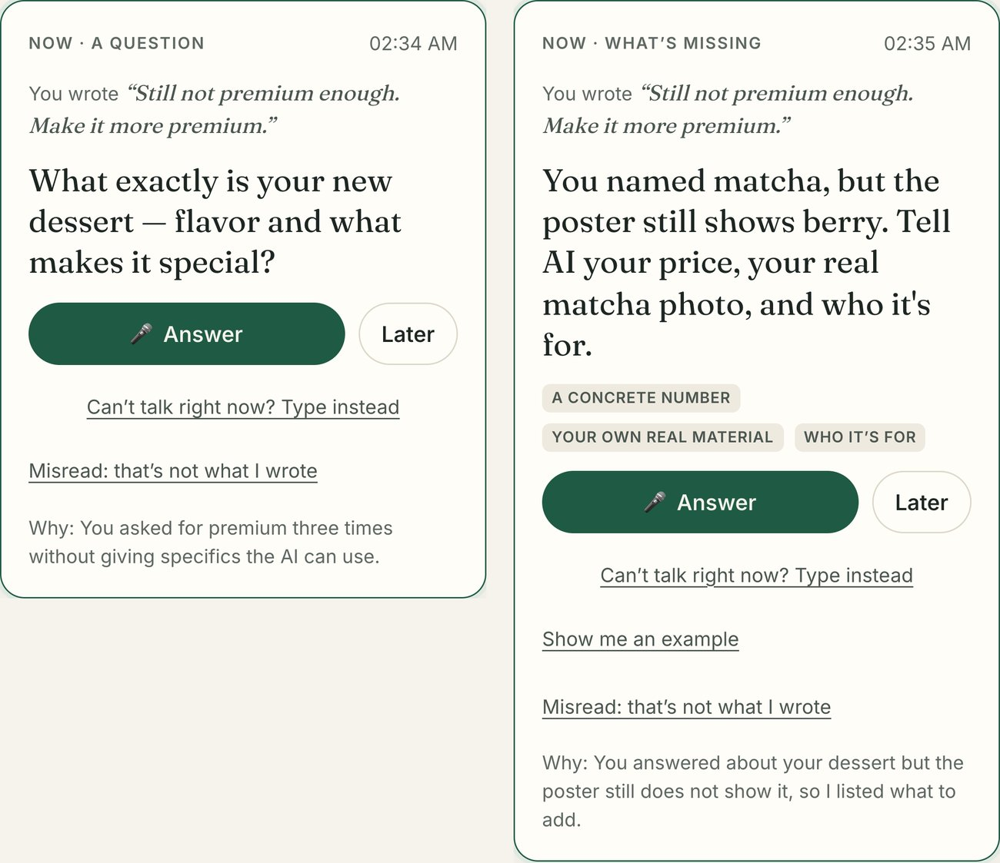

The Desk keeps the record of the session, moment by moment: what you said, what the Caddie did, and what changed.

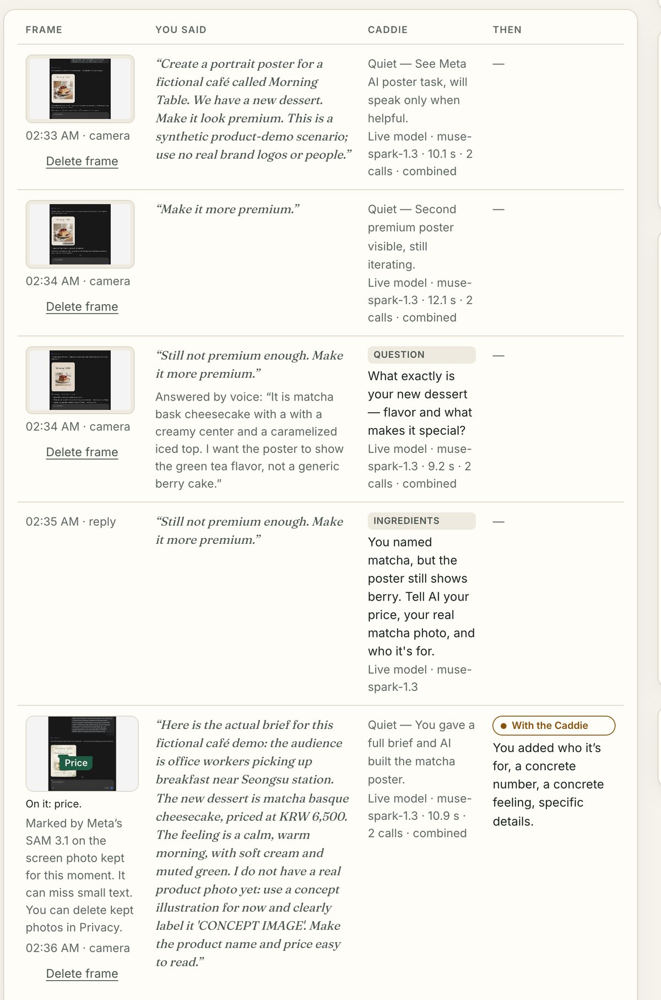

## What the session leaves you

The Caddie makes only what the session earned, each with a one-line reason: a **note**, **My playbook** (what to tell your AI, what you decide), **flashcards** that come back later, a **two-voice podcast** you can interrupt, and a **9:16 short** built on your own before and after screens. In this run it skipped the podcast and said why.

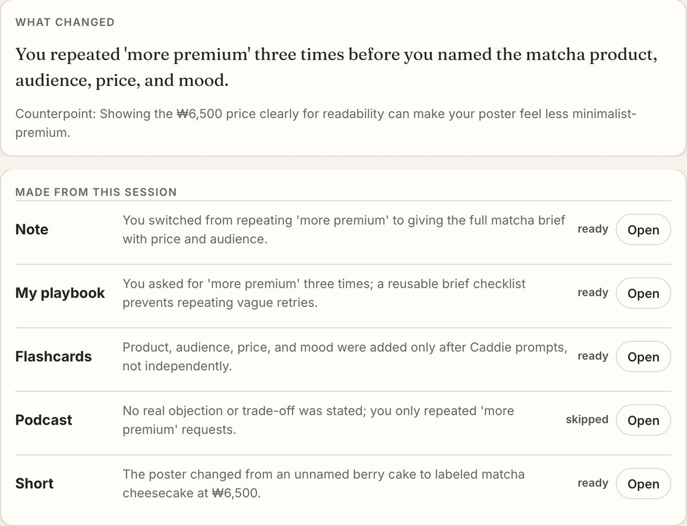

The recorded sample session includes a podcast made on request (its guest is a character the model wrote) and a short; both play at [/sample](https://coevo-caddie.coevo-meta-hackathon.workers.dev/sample).

## Practice Range

A new request arrives; you brief the AI out loud or by typing; Muse Image draws what your words produce; and the Caddie checks which details your brief includes.

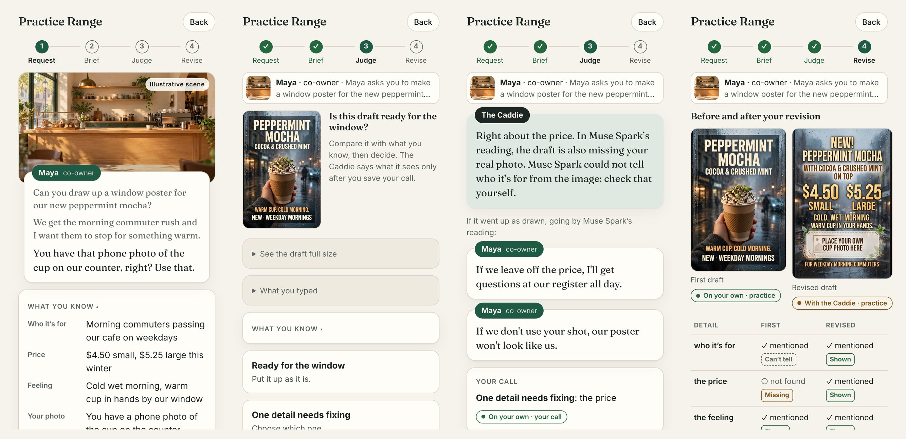

<sub>A separate sample session with a typed, scripted brief. The brief asks for a real photo; no photo was attached, so the check is about what the brief names.</sub>

## Your AI learns too

At the end, the Caddie proposes a **Caddie card** for your AI. You decide: approve, edit or reject.

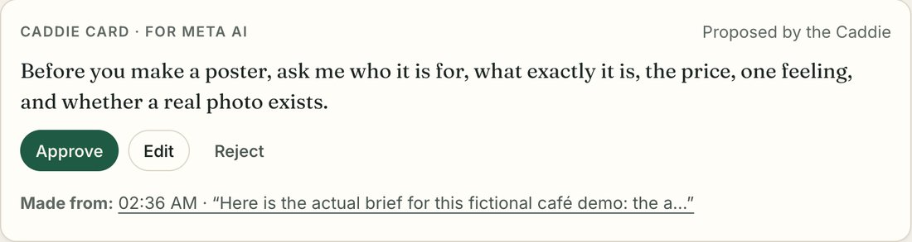

Send an approved card as the first message of a dedicated chat and pin it. In separate recorded checks, Meta AI chats that began with a card from an earlier run asked for those details first when asked for a new drink poster, and the Caddie stayed quiet. This works inside that chat; in our check Meta AI did not carry the rule into other new chats.

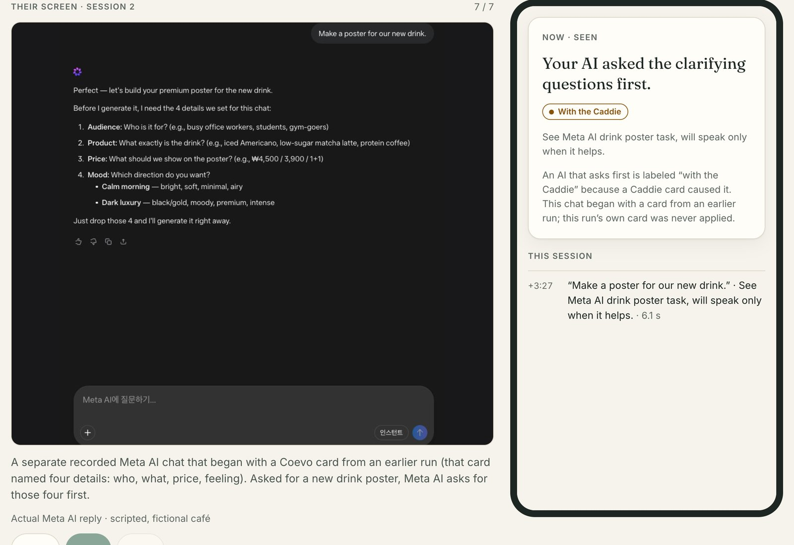
<sub>From the recorded sample session: a separate chat that began with a card from an earlier run. This run's own card was only proposed.</sub>

## Honest by design

- Every observation is labeled *on your own*, *with the Caddie*, *AI wrote it* or *not seen yet*. *Not seen yet* never means you can't.
- Nothing the Caddie says is pre-written. Readings, decisions and content are live model output; when a call is off, refused or fails, the app says so instead of inventing output.
- The café owner is scripted and fictional; the AI screens are actual replies to that script. Physical phone-camera accuracy and a human voice were not measured: the phone setup is verified in a phone-sized browser with a controlled camera and a synthetic voice. Details: [Current status](docs/STATUS.md) · [Verification matrix](docs/VERIFICATION.md).

## Built on Meta's models

- **Muse Spark 1.3** reads each screen into a structured moment, decides whether to speak (and why it stays quiet), plans one learning design per session and writes the five formats.
- **SAM 3.1** finds the monitor in one disclosed setup photo, so the phone crops on-device afterwards, and points at a poster's price, title or photo on a kept frame.
- **Muse Voice Transcribe** turns spoken answers and practice briefs into text.
- **Muse Image** draws what a practice brief produces, and scenes for the short.

Podcast and short voices use the open-source **Kokoro-82M** (Apache-2.0) on Modal, because Meta's API has no text-to-speech.

Built for the 2026 Meta Global AI Developer Hackathon (Indie Developer · Build for Your World). The Coevo Caddie app was newly implemented during this hackathon, based on the author's earlier Coevo concept; all code in this repository was written during the event.

## Run it yourself

Requirements: Node.js 22.12+ and npm. Python 3.12+ with ffmpeg, numpy and Pillow for the optional media checks.

```bash
git clone https://github.com/dkssudgo112/coevo-meta-hackathon.git
cd coevo-meta-hackathon
npm ci
npm run setup
npm run build
npx wrangler dev --local --ip 127.0.0.1 --port 8788
```

- Open http://127.0.0.1:8788. The Worker serves the app, API, Durable Objects and local R2.
- `npm run dev` runs Vite with hot reload on :5178 against the API on :8788.
- Phone cameras require HTTPS; use the deployed URL or an HTTPS tunnel to test with a real phone.
- Live model calls are **off** by default. To turn them on, set your own `MODEL_API_KEY` and `COEVO_ALLOW_LIVE_CALLS="true"` in `.dev.vars`. See [API setup](docs/API-SETUP.md).

```bash
npm run verify             # type checks, unit tests, build, Worker dry-run, release checks
npm run test:integration   # HTTP checks against a running server (default http://127.0.0.1:8788)
npm run test:media         # media composition with a synthetic tone (no TTS, no Modal)
```

| Path | Purpose |
| --- | --- |
| `apps/web` | React + TypeScript app: phone Caddie, PC Desk, sample session, demo page |
| `apps/api` | Cloudflare Worker, `Workspace` and `Budget` Durable Objects, Meta and media adapters |
| `packages/contracts` | Shared types: moments, decisions, evidence labels, cards, content |
| `packages/core` | Model task prompts and schemas, guardrails, labeling rules, change detection, spaced repetition, spend limits |
| `infra/modal` | Media service: Kokoro TTS + ffmpeg composition |
| `scripts` | Setup, integration checks, release checks |
| `docs` | Product, verification, build plan, decisions, submission |

**Documentation:** [Status](docs/STATUS.md) · [Product](docs/PRODUCT.md) · [Verification matrix](docs/VERIFICATION.md) · [Build plan](docs/BUILD-PLAN.md) · [Decisions](docs/DECISIONS.md) · [API setup](docs/API-SETUP.md) · [Hackathon](docs/HACKATHON.md) · [Submission](docs/SUBMISSION.md) · [Sources](docs/SOURCES.md)

A project license has not been selected yet; public visibility alone does not grant an open-source license.
